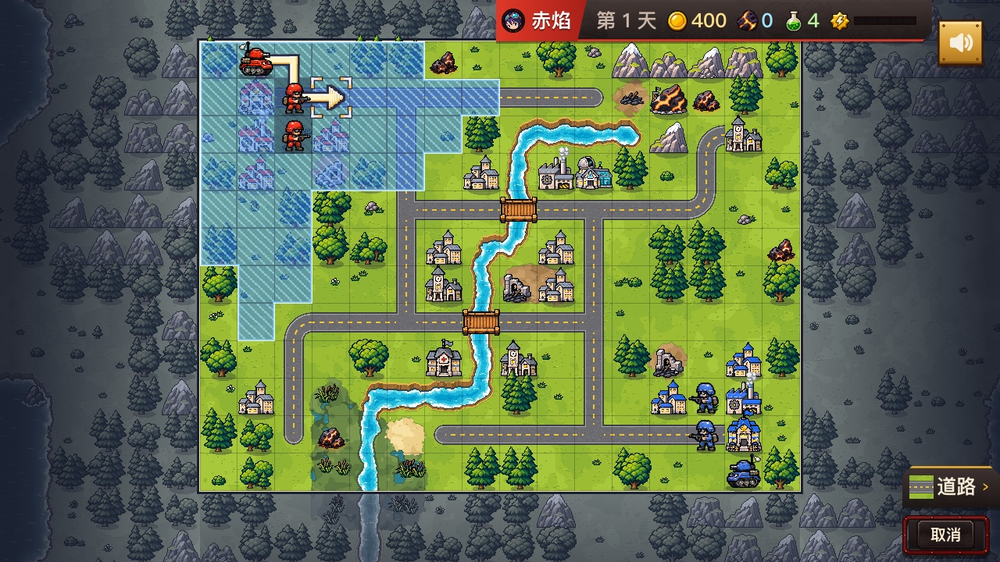

# Tidemark (潮汐战线)

[中文](README.zh-CN.md)

*Where the tide leaves its mark.*

Classic turn-based strategy in the spirit of Advance Wars: build, capture and push the front with 33 land, sea and air units, 29 commanders and a 27-mission campaign. The whole game is open source (MIT). The code is in [`game/`](game/): plain HTML and JavaScript with no build step, so opening `game/index.html` is enough to play.



## How to play it

- **Web**: open <https://dsh-game-store.com/games/tidemark/> and click Play now
- **DSH**: install the Game Store (`dsh-game-store`) in DeepSeek Harness, find Tidemark, click Install, then Play
- **Locally**: clone this repository and open `game/index.html`
- Manual: <https://dsh-game-store.com/games/tidemark/manual/>

## What is in this repository

| Where | What |
| --- | --- |
| `game.json` | The game manifest: name, summary, entry, pictures, languages, controls |
| `store/` | What the store shows: icon, cover, screenshots, description |
| `scripts/pack.mjs` | Builds the package from the game's working folder |
| `scripts/shots.cjs` | Takes the cover and screenshots from the packed game |
| `game/` | The game itself (source; synced from the game's working folder when packing) |
| `manual/` | The generated manual (about 55 MB, not in git; read it on the site) |

## Build the package

```bash
node scripts/pack.mjs --tarball
```

The script only reads the game's working folder (set it with `--source` or `TIDEMARK_SOURCE`) and rebuilds `game/` and `manual/` from scratch, so it is safe to run at any time. It copies the files the game needs to run, confirms every script `index.html` names was copied, adds the manual (skip it with `--no-manual`), checks the package against the store spec, and with `--tarball` runs `npm pack` and prints the checksum.

## License

MIT, see [LICENSE.md](LICENSE.md): use, change and republish the code, maps, text and art freely. The game font is Fusion Pixel Font, used under the SIL Open Font License 1.1.
